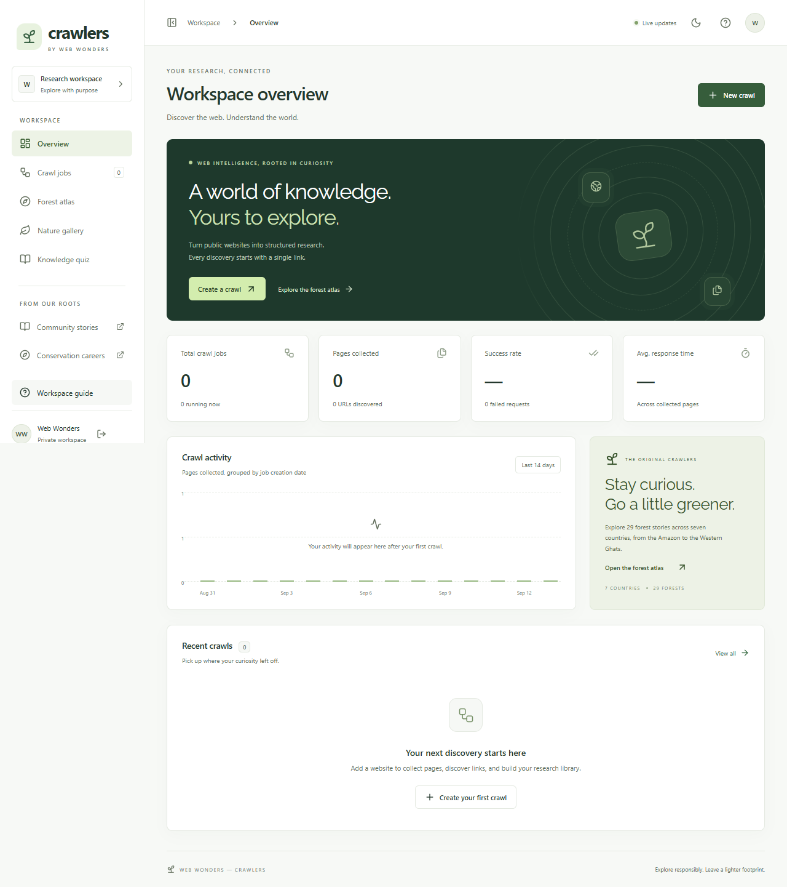

# Web Wonders — Crawlers

A forest exploration project upgraded with a secure web research workspace. Explore the original **29 forest articles across seven countries**, take the eight-question quiz, and collect structured research from public websites.

The original project won first place in the Web Wonders competition. Created by **Dev Shrut Jain, Nilang Bhuva, and Suhani Acharya**, with guidance from **Darshan Vekariya, Lavanya Pinjarkar, and Saketh Kanuri**.

## The upgrade

The original repository was a static HTML/CSS/JavaScript site. It contained no server, database, crawler engine, authentication, package manifest, or tests. Blog, careers, and tree-planting links lead to separate applications; their code and data are not in this repository. The upgrade is additive: the original site is retained at `/legacy/index.html`, and original files remain in place.

The application is now fully migrated to **Next.js 16 App Router**, including all API endpoints. Routes are `/`, `/jobs`, `/jobs/[id]`, `/forests`, `/forests/[id]`, `/quiz`, and `/gallery`. Next Link navigation preserves workspace state; public forest content is rendered on the server with page metadata. Existing hash bookmarks are redirected in the browser. The original source collection remains as an archive, not a second application runtime.

See [source audit](docs/AUDIT.md), [architecture](docs/ARCHITECTURE.md), and [validation evidence](docs/VALIDATION.md).

## Features



- Responsive Next.js dashboard with light/dark modes, real crawl statistics, activity chart and live progress.
- Create, pause, resume, stop, inspect and delete jobs; retry failed pages.
- Persistent SQLite queue, concurrent requests, strict page/depth limits, host/path restrictions and restart recovery.
- Searchable results, status filters, sorting, pagination, detailed inspection, CSV summaries and full JSON exports.
- Titles, descriptions, headings, text, links, images, canonical URL, language, word count, JSON-LD, HTTP status, response timing and errors.
- Mandatory robots handling, crawl delay, optional sitemap/index discovery, retries, Retry-After handling, deadlines and response-size limits.
- DNS validation and IP pinning, private/reserved IP blocking, redirect checks, API authentication, rate limits, browser request guards, CSP and safe CSV output.
- Server-rendered forest atlas and article reader, complete quiz with answer review, and 84-photo searchable gallery with an accessible viewer. Original pages and external community links are preserved.
- Server-held optional legacy weather credential, environment validation, structured logs, tests, Docker configuration and CI.

## Stack

| Layer        | Technology actually used                                                          |
| ------------ | --------------------------------------------------------------------------------- |
| UI           | Next.js 16 App Router, React 19, TypeScript, TanStack Query 5, Lucide, CSS tokens |
| API          | Next.js Node Route Handlers, Zod 4, Pino logs                                     |
| Crawler      | Node HTTP/HTTPS, Cheerio 1.2, robots-parser, ipaddr.js                            |
| Storage      | SQLite through `node:sqlite`, WAL journaling, SQL transactions                    |
| Verification | Node test runner, Playwright, axe-core, TypeScript, ESLint                        |
| Delivery     | npm lockfile, Dockerfile, Compose, GitHub Actions                                 |

Deploy with **Node 24 LTS**. Local compatibility starts at Node 22.13, which prints an experimental warning for its built-in SQLite API. Exact dependency versions are in the lockfile. This is a **single-instance, single-owner workspace**; HTTP crawling fits the current requirements without Redis, an LLM, or browser-rendered scraping.

## Run locally

```powershell
cd D:\Crawlers
npm ci
npm run dev
```

Open **http://localhost:3001**. Pages, API, SSE and assets run on this single Next.js server. `predev` generates the forest, quiz and gallery collection plus the legacy compatibility copy. Next.js handles hot reload; restart the dev server after changing the long-lived crawler/runtime modules. Credentials are optional on the default loopback development address.

For the compiled application, configure `CRAWL_API_KEY` in `.env` first (see below). Production refuses to start without it:

```powershell
npm run build
npm start
```

Open **http://localhost:3001**. Opening the root `index.html` directly still opens the original static site; the new application requires the Node server.

## Environment

Copy `.env.example` to `.env` to override defaults. Never commit `.env`.

| Variable              | Default / requirement                                                           |
| --------------------- | ------------------------------------------------------------------------------- |
| `HOST`                | `127.0.0.1`; authentication required for public binding                         |
| `PORT`                | `3001`                                                                          |
| `APP_ORIGIN`          | `http://localhost:3001`; exact public origin, no path/trailing slash            |
| `DATABASE_PATH`       | `./data/crawlers.sqlite`                                                        |
| `CRAWL_API_KEY`       | Random secret of at least 32 characters; mandatory in production/public binding |
| `NODE_ENV`            | Set by the entry point: development for `dev`, production for `start`           |
| `LOG_LEVEL`           | `info`; supports fatal/error/warn/info/debug/trace/silent                       |
| `OPENWEATHER_API_KEY` | Optional server-side weather credential for legacy country pages                |

Generate a fresh key locally with `node -e "console.log(require('node:crypto').randomBytes(32).toString('hex'))"`, save it in `.env`, and enter it on the sign-in screen. The browser receives an HttpOnly, SameSite=Strict, 12-hour signed cookie. Cookies use Secure when `APP_ORIGIN` is HTTPS. API clients use `Authorization: Bearer <key>`. The key grants access to the entire workspace; there are no separate users or roles.

**Credential action:** the original repository committed a weather credential in client JavaScript. It is removed from current source but remains in Git history. Revoke/rotate it with the provider before enabling weather. History has deliberately not been rewritten.

## Crawler settings

| Setting           | Default   | Bounds / meaning                                            |
| ----------------- | --------- | ----------------------------------------------------------- |
| Starting URL      | Required  | Public HTTP(S), no credentials, ports 80/443 only           |
| Page limit        | 50        | 1–500 admitted URLs, including failures/blocks              |
| Depth             | 2         | 0–5; seed depth 0; sitemap URLs depth 1                     |
| Concurrency       | 3         | 1–6 requests within the active job                          |
| Request spacing   | 750 ms    | 200–10,000 ms; includes robots/sitemaps/redirects/retries   |
| Timeout           | 10,000 ms | 1,000–30,000 ms plus enforced spacing allowance             |
| Retries           | 2         | 0–3 per processing run                                      |
| Sitemap discovery | Off       | At most five same-host sitemap documents, including indexes |
| Path prefix       | Empty     | Optional literal pathname prefix; seed must match           |

Crawls remain on the seed hostname. HTTP-to-HTTPS redirects on that host are allowed; redirects to another hostname, including `www`, are blocked. Enter the final hostname for such sites. Fragments/default ports are normalized; query order is retained so signed URLs are not mutated. A database uniqueness constraint deduplicates identical URLs. Redirect aliases can still yield equivalent content.

Robots checks are mandatory: 404/410 permits crawling, 401/403 denies it, and server/transport failure stops the job conservatively. Redirect targets are checked too. Crawl delays above 120 seconds are unsupported; Retry-After above 120 seconds fails that request. Missing optional sitemaps do not fail ordinary discovery.

Response limits: HTML 2 MiB, robots 512 KB, sitemap 1,024 KB. Identity encoding is requested; gzip, deflate and Brotli responses are also supported with limits on both wire and decompressed bytes. Stored text is capped at 150,000 characters, links at 5,000, headings/images at 100, and JSON-LD at ten entries of 20,000 characters each. HTML is parsed as data. Crawled images are shown as links/alt text rather than loaded automatically.

The workspace holds at most 100 jobs. Export/delete old work to manage disk usage. Progress means processed/admitted URLs; its denominator grows during discovery. Completed jobs may contain failures, blocks or non-HTML skips. Stop retains records; resume is available for paused jobs. Retry requeues failed pages while retaining successes.

## Architecture and storage

```text
Next.js App Router pages + React workspace
                  | REST + SSE
       Next.js Node Route Handlers
                  |
         SQLite jobs + pages
                  |
       Durable FIFO job scheduler
                  |
    Robots -> rate gate -> DNS checks
                  |
       Pinned HTTP(S) + redirects
                  |
      Cheerio -> results + new URLs
```

The Next.js migration keeps schema version 1 and the exact same database path. **No database migration is required.** Existing jobs, queue records and results remain valid. A new installation creates the schema on first start. No external community database was accessed or changed. `jobs` stores configuration/lifecycle; `pages` stores queue state, extraction, attempts, timing and errors with unique `(jobId, url)`. Page completion and discovered URLs commit together.

On restart, running jobs become paused and unfinished page claims become queued. Queued jobs continue automatically. SIGINT/SIGTERM abort requests and retain jobs as paused. Back up the entire `data` directory **after stopping the app**, including WAL/SHM files if present. Do not copy only a live `.sqlite` file. Restore at the configured path. Do not run multiple replicas against one database.

## API reference

Crawl endpoints require a session or bearer key when authentication is configured. Use JSON request bodies and the configured Host/Origin. Cross-site browser requests are rejected. Errors have an `error` message and, for crawler errors, a `code`.

| Method / path                         | Purpose                                         |
| ------------------------------------- | ----------------------------------------------- |
| `GET /api/health`                     | Public health/database check                    |
| `GET /api/session`                    | Authentication status                           |
| `POST /api/session`                   | Sign in with `{ "key": "..." }`                 |
| `DELETE /api/session`                 | Clear browser session                           |
| `GET /api/library`                    | Public original articles, quiz and gallery      |
| `GET /api/weather?lat=…&lon=…`        | Optional cached weather proxy                   |
| `GET /api/jobs`                       | Jobs/statistics                                 |
| `POST /api/jobs`                      | Validate, create and enqueue                    |
| `GET /api/jobs/:id`                   | Job details/progress                            |
| `POST /api/jobs/:id/control`          | `{ "action": "pause" }`; also resume/stop/retry |
| `DELETE /api/jobs/:id`                | Delete inactive job and results                 |
| `GET /api/jobs/:id/pages`             | Filtered/paginated summaries                    |
| `GET /api/jobs/:id/pages/:page`       | Full extraction                                 |
| `GET /api/jobs/:id/export?format=csv` | CSV summary; `format=json` for full results     |
| `GET /api/events`                     | SSE updates/heartbeats                          |

Page queries accept `search`, `status`, `offset`, `limit` (1–100), and `sort=url|title|response`; `url` means discovery order. Page states: queued, fetching, success, failed, blocked, skipped.

Example job body:

```json
{
  "url": "https://example.com",
  "name": "Example research",
  "maxPages": 25,
  "maxDepth": 2,
  "concurrency": 3,
  "delayMs": 750,
  "timeoutMs": 10000,
  "retries": 2,
  "useSitemap": false,
  "pathPrefix": ""
}
```

Limits per socket IP: 240 API requests/minute, 20 new jobs/hour, eight sign-ins/minute. At most 30 SSE connections; slow consumers are closed. SSE notifications are coalesced once per second, with 15-second polling fallback. Streams have a 30-minute maximum lifetime; authentication is checked on reconnect. API data is not cached. The custom host overwrites transport identity headers; untrusted forwarded headers cannot bypass limits.

## Verification and development

```powershell
npm run typecheck
npm run lint
npm test
npm run build
npm run test:e2e
npm run test:next
npm run test:dev
npm audit --audit-level=high
```

`npm run check` runs types, lint, backend tests and build. `test:next` verifies production startup and graceful shutdown against a temporary database; `test:dev` checks the same lifecycle in Next development mode. Run the production build before production/browser checks. Browser tests use installed Chrome locally; with `CI=true` they use Playwright Chromium (`npx playwright install chromium`). Tests use an isolated database/fixture server, never the real workspace. The HTTP transport suite uses a real local HTTP server with a test-only socket adapter. `npm run test:live` attempts a bounded public crawl and needs outbound DNS/HTTPS access. It fails honestly if external networking fails.

`npm run format` formats new code; original assets are excluded. Browser reports, traces and screenshots are under ignored test directories. View reports using `npx playwright show-report`.

## Deployment

The complete application needs a long-running Node process and persistent disk. This Next.js app uses a small custom Node host for crawler lifecycle and SSE shutdown. Use `npm start` or the Docker image, not `next start`, a static export, or ephemeral serverless functions. Next.js owns every page, API route and static asset; there is no separate Vite/Fastify server. Standalone output is intentionally disabled because Next.js custom servers are incompatible with it.

1. Set `NODE_ENV=production`, `CRAWL_API_KEY`, and public HTTPS `APP_ORIGIN`.
2. Run `npm ci`, `npm run build`, `npm start`; or `docker compose up --build -d` with `.env` configured.
3. Keep one replica. Compose binds port 3001 to localhost and persists `/app/data` in a named volume.
4. Put a TLS reverse proxy in front. Preserve the public Host, disable buffering for `/api/events`, and permit long-lived SSE connections. Forwarded IP headers are deliberately not trusted; behind a proxy, clients may share rate limits.
5. Add public-only HTTP(S)/DNS egress rules. Monitor health, disk usage, failed jobs and structured logs. Back up stopped databases and keep dependencies patched.

Docker runs as a non-root user. Compose drops capabilities and sets a memory limit. CI installs, checks, builds, audits and runs browser tests. Docker and hosted CI must be validated on the deployment host; the validation report distinguishes executed checks from supplied configuration.

## Key files

| Location                                  | Responsibility                                                                  |
| ----------------------------------------- | ------------------------------------------------------------------------------- |
| `app/`, `components/`                     | App Router pages, shell, dashboard, inspector, atlas, quiz, gallery, CSS tokens |
| `public/`                                 | Generated source content, local font and compatibility assets                   |
| `app/api/`, `server/api.ts`               | Route handlers, authentication, validation, SSE and exports                     |
| `server/runtime.ts`, `instrumentation.ts` | One crawler/database instance per process and startup recovery                  |
| `proxy.ts`                                | Per-request script nonces and page security headers                             |
| `server/store.ts`                         | Schema, transactions, queue/results                                             |
| `server/crawler/`                         | URL/IP policy, HTTP transport, parser, scheduler                                |
| `shared/types.ts`                         | Types and Zod settings schema                                                   |
| `scripts/`                                | Custom Next host, content import, legacy build, live smoke                      |
| `tests/`                                  | Security, HTTP, crawler, database, API, browser checks                          |
| `docs/`                                   | Audit, architecture, actual validation evidence                                 |
| `Country/`, `Quiz/`, others               | Original content retained in place                                              |

## Useful future work

- Review historical forest facts/coordinates and move external legacy images to owned storage.
- Add identity-provider login, user ownership, quotas and audit events before offering multi-user access.
- Add PostgreSQL/job leases/shared queue before multiple workers or replicas.
- Add content hashes, scheduled recrawls and change comparisons for repeated research.
- Add browser rendering or LLM extraction only for a concrete requirement and with measurable quality/resource budgets.

External applications and historical content remain source material; their uptime and factual freshness are not guaranteed by this upgrade. The previous README is retained in `README.original.md` for project history; its technology claims are superseded by this source-verified documentation.
